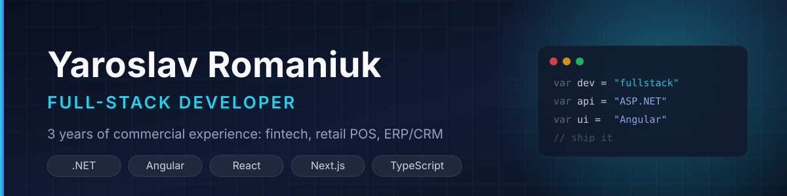

  

  
  
  

---

Full-Stack Developer with 3 years of commercial experience. Two years on ASP.NET Core + Angular (retail POS, ERP/CRM), in parallel with TypeScript products on React, React Native, Next.js and NestJS.

I take features end-to-end: database schema, API, then the UI.

### What I have built

- **Retail ERP & CashDesk** for a grocery chain: POS and CRM on .NET + Angular, document flow across 1C, CRM and cash registers, kept balanced by a storno-based regression mechanism over RabbitMQ.
- **Real-time payments platform (South Africa)**: React Native app with QR payments and biometric auth, embedded checkout, POS page, merchant and admin portals on Next.js.
- **Health benefits platform (US, ICHRA)**: multi-role React 19 SPA with census import, affordability calculations and document e-signature.
- **EdTech marketplace (Brazil)**: Next.js storefront with Stripe and local payment methods, EN/PT.
- **Base-station monitoring dashboard**: Angular + NgRx with OpenLayers WebGL rendering of hundreds of map features.

### Stack

  
  
  
  
  
  
  
  
  
  

  
  
  
  
  
  
  
  
  

### GitHub

  
  

### Currently

Studying Software Engineering at DUICT (graduating 2027) and working as a full-stack developer. Growing toward heavier backend work: queues, integrations and performance.
